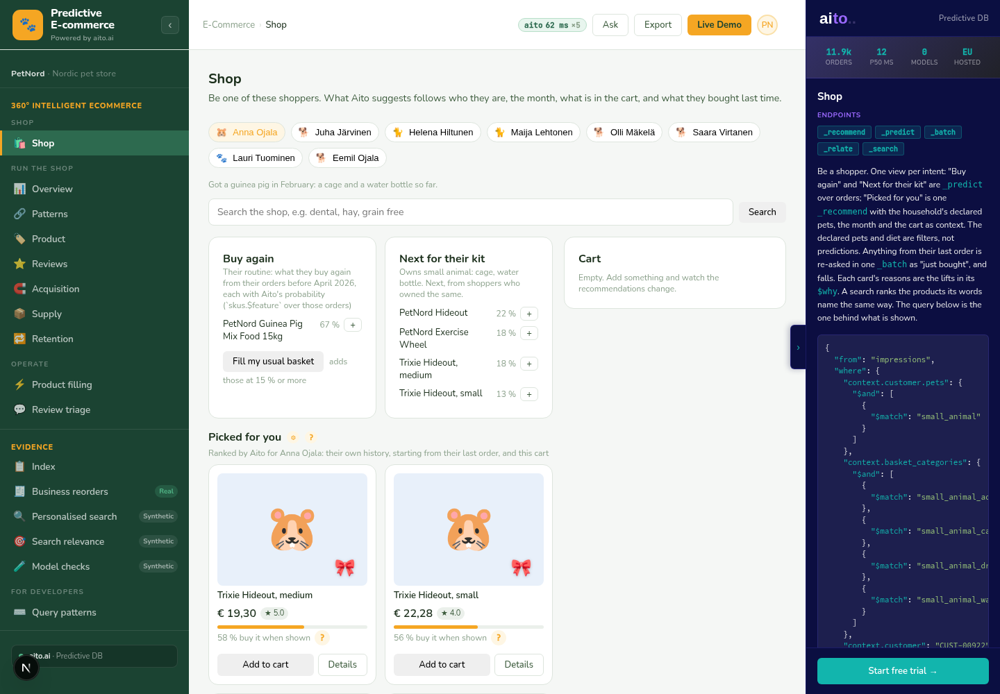
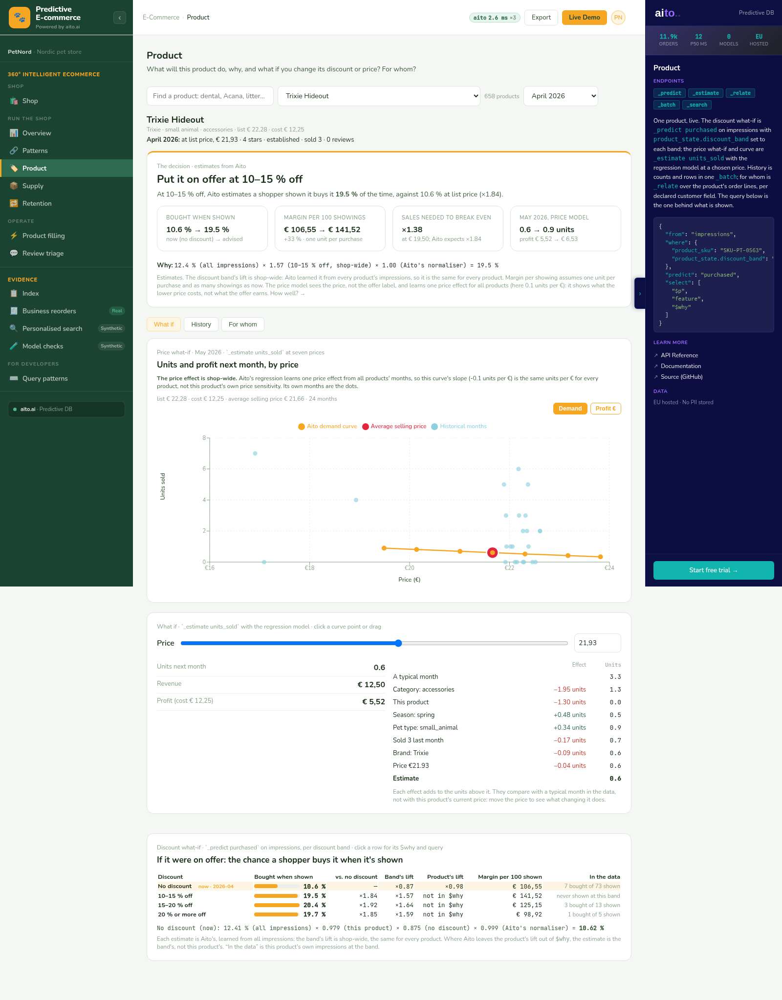
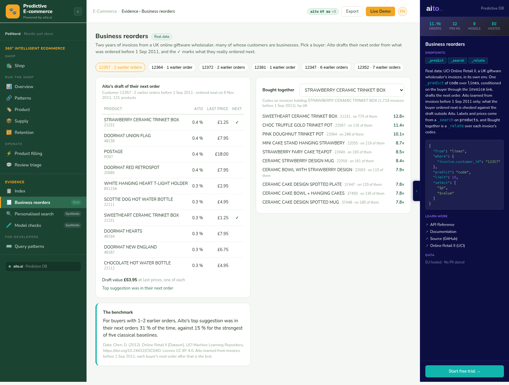

# Predictive E-commerce: an Aito.ai demo

PetNord is an online pet store where every screen runs on predictions: the
shop a shopper sees, the owner's decisions (what to put on offer, what to
reorder, who is about to leave), and an agent that reads the same store
memory. It all runs on one [Aito.ai](https://aito.ai) predictive database,
with no model training and no retraining schedule. The
[Aito docs](https://aito.ai/docs/api/v2/) explain the queries; this repo
shows them in a working shop.

[](LICENSE)
[](https://aito.ai)

---

## See it in action

Live at **[ecommerce.aito.ai](https://ecommerce.aito.ai)**. The partner
walkthrough (5–7 minutes) is [`docs/demo-script.md`](docs/demo-script.md).

**The Shop.** Päivi got a guinea pig in February. "Next for their kit"
leads with the hideout, which shoppers who owned a cage and a bottle
bought next. "Picked for you" is one `_recommend` with her declared pets,
the month and her cart.



**The owner's decision.** One product: the chance it is bought when shown
at each discount band, the margin per 100 showings, and the reasons from
Aito's `$why`. In a sandbox, the owner pulls the lever and watches
Päivi's Shop react.



**Evidence, on real data.** On UCI Online Retail II: "For buyers with 1–2
earlier orders, Aito's top suggestion was in their next orders 31 % of the
time, against 15 % for the strongest of five classical baselines."



PetNord's data is generated, with planted effects: it shows how Aito works,
not how much it would lift a real shop. Accuracy numbers live only in the
Evidence section, each page marked Real or Synthetic data
([ADR 0037](docs/adr/0037-an-evidence-section.md)).

---

## Quick start

```bash
git clone https://github.com/AitoDotAI/aito-ecommerce-demo
cd aito-ecommerce-demo
cp .env.example .env      # 1. your Aito URL and key (a read-only key is enough)
./do setup                # 2. Python and Node dependencies
./do dev                  # 3. http://localhost:8500
```

Until the release data is promoted onto the demo database's master
(ADR 0035, the cutover of 2026-10-24), read it from its env:
`AITO_ENV=observable ./do dev`. After the cutover, plain `./do dev`.

`./do help` lists every command. To load the data into a database of
your own: `./do generate-fixtures`, then `./do reset-data` (see "Your own
database" below).

---

## How it works

```
Browser → Next.js (8500) → /api/... → FastAPI (8501) → AitoClient → Aito v2 REST API
                                                            ↘ sandbox branch (opt-in)
```

- **One service per view.** `src/<view>_service.py` builds the Aito query
  bodies, calls `AitoClient` and returns what the page renders. Every
  page's Aito panel shows the body that ran.
- **Only what a shop observes** ([ADR 0033](docs/adr/0033-only-what-a-shop-observes.md)).
  `impressions` (a product shown, clicked, carted, bought) link to
  `contexts` (the shopper, month and cart) and to `product_states` (the
  product as it was that month: price, offer, stars). Customers hold only
  what they declared. A query reaches `context.customer.pets` or
  `product_state.discount_band` through the links, with no joins.
- **Heavy views are precomputed** ([ADR 0024](docs/adr/0024-precompute-and-serve-store.md)).
  `./do precompute` snapshots them, so the read-only public deploy opens
  each in under a second.

### The site, by who asks

| Section | Views | Aito |
|---|---|---|
| **360° intelligent ecommerce: Shop** | Shop: Buy again, Next for their kit, Picked for you, search, cart, product drawer | `_recommend`, `_predict`, `_search` with `$similarity`, `_relate`, `_batch` |
| **Run the shop** | Overview · Patterns · Product · Supply · Retention | `_relate` with intervals; `_predict purchased` per discount band; `_estimate units_sold`; `_predict churned_in_3_months` |
| **Operate** | Product filling · Review triage | `_predict` with `$why`, several fields in parallel |
| **Evidence** | Business reorders (Real) · Personalised search · Model checks | committed results; `_evaluate` |
| **For developers** | Query patterns: one minimal call per endpoint | — |

Each owner view leads with the decision it supports ("Put it on offer at
10–15 % off"), its estimated impact, and the reasons from `$why`. Each
links to the Evidence page that says how well
([ADR 0041](docs/adr/0041-one-view-per-job.md)). Old routes such as
`/smart-search` and `/bought-together` redirect to their new home.

### The sandbox: pull a lever, watch the shop react

[ADR 0043](docs/adr/0043-pull-a-lever-in-a-sandbox.md). The owner puts a
product on offer or adds a review, in a throwaway copy of the store:

- **It's opt-in.** It exists only when the server's config holds
  `AITO_SANDBOX_URL` (a database whose name contains `sandbox`) and its
  key. Without them every lever endpoint answers 404, and the banner
  doesn't show.
- **It never touches master.** While sandboxes are configured, PetNord's
  database is read through a client that refuses every write. The
  sandbox is a database of its own, and each "New sandbox" is a
  copy-on-write branch of its template, deleted after 3 hours.
- **A lever writes next month's state** (May 2026), reads it back, and the
  Product view asks its estimates again. The Shop for May re-scores its
  top 40 by Aito's shop-wide lifts of the offer and star bands. A
  re-scored card shows its own explanation, which multiplies out to its
  score.
- **An agent reads the same branch:** `./do agent-demo <branch>` runs
  Claude Code with Aito's MCP server (`aito-mcp`) as its only tools, with
  a read-only key and writes refused.

### Aito operators used

| Operator | Used in |
|---|---|
| `_recommend` | Shop "Picked for you" and search; Query patterns |
| `_predict` | Shop kit and Buy again; Product's discount what-if; Retention; Product filling; Review triage; Business reorders |
| `_estimate` | Supply's forecast; Product's price what-if (regression) |
| `_relate` | Patterns (baskets, what goes with a purchase, who buys what); the Shop drawer; Product's buyers |
| `_search` | Overview counts; Shop search (`$similarity`); read-backs |
| `_evaluate` | Evidence › Model checks |
| `_modify` | Sandbox levers only |

Verified query bodies and the Aito gotchas met on the way are in
[`docs/aito-cheatsheet.md`](docs/aito-cheatsheet.md).

### Your own database

`AITO_API_URL` in `.env` may point at a shared instance. Put a dev
instance in `.env.local` (gitignored; it wins over `.env`). `./do` refuses
the commands that write (`load-data`, `reset-data`, `clear-cache`) when the
URL is the shared demo database, unless you set `AITO_ALLOW_PROD=1`.

```bash
# .env.local
AITO_API_URL=https://shared.aito.ai/db/aito-ecommerce-dev
AITO_API_KEY=your-dev-instance-key
```

The data is deterministic (`data/generate_fixtures.py`, seed 42), so a
dev instance is an exact copy. The release's row counts are in
`data/release-env.json`: 658 products, 3,000 customers, 11,909 orders,
39,098 order lines, 117,026 impressions, 15,157 product states, 6,000
reviews.

`GET /version` says which commit and which Aito env a deployment runs
(`"api": "v2@observable"`). Set `BUILD_SHA` at build time.

---

## Project structure

```
src/                   FastAPI backend: app.py lists every endpoint
  aito_client.py         thin REST client; read-only and sandbox write modes
  shop_*.py              the Shop: ranking, kit, search, drawer, re-scoring
  product_service.py     Product: the decision, discount and price what-ifs
  discount_what_if.py    _predict purchased per discount band
  product_levers.py      the sandbox levers: write May, read it back
  sandbox_*.py           sandbox config, branches, warm-up, CLI
  overview_service.py · shop_analytics_service.py (Patterns) · supply_service.py
  retention_service.py · filling_service.py · review_triage_service.py
  uci_*.py               Business reorders on UCI Online Retail II
frontend/              Next.js (App Router), one page per view
  app/<view>/page.tsx    pages; app/evidence/ for Evidence
  components/            shell (sidebar, Aito panel, sandbox banner), shop, product, ...
  lib/moved-routes.ts    old routes and their new home
data/                  deterministic fixtures, the release's counts, UCI outcomes;
                       contexts and impressions are generated, not committed;
                       answer_key/ is the generator's hidden model, never loaded
scripts/               sweeps and probes; agent-demo/ for Flow 3's agent
tests/                 pytest: query shapes and services, read as usage examples
docs/
  adr/                   Architecture Decision Records
  aito-cheatsheet.md     verified query patterns and Aito gotchas
  demo-script.md         the partner walkthrough
  notes/ · sessions/     working notes and session logs
  verification/          verification reports
do                     task runner: ./do help
```

---

## ADRs

Read them in order for the design's rationale. All are in
[`docs/adr/`](docs/adr/).

| # | Decision |
|---|---|
| 0001–0004 | Stack, deterministic data, the Aito schema and loader, the layout shell |
| 0005–0016 | The first views: Dashboard, Smart Search, For You, Bought Together, Product Filling, Evaluation, Patterns, Feedback, Churn, Demand, Inventory, Price |
| 0017–0022 | Customer traits, Markdown, Cart completion, Win-back, impressions as the recommendation KPI, basket rules |
| 0024 | Precompute and serve the heavy views |
| 0025 | Move to Aito API v2 |
| 0026 | Search as a blend of text and purchase probability |
| 0027–0029 | Purchase data with a lifecycle; Product insights; the price what-if |
| 0030–0031 | Shoppers with a story; the interactive Shop and the owner's view of its patterns |
| 0032 | [Product states](docs/adr/0032-product-states.md): a product as it is this month (price, offer, stars) |
| 0033 | [Only what a shop can observe](docs/adr/0033-only-what-a-shop-observes.md): impressions, contexts, declared customers |
| 0034 | [A business buyer's next order on real data](docs/adr/0034-business-reorders-on-real-data.md) (UCI), with the claim as cleared |
| 0035 | [The data promotion is a step of the deploy](docs/adr/0035-data-promotion-in-the-deploy.md): the app waits for its data release |
| 0036 | [Backtest the reorder suggestion](docs/adr/0036-reorder-backtest-on-a-merchants-orders.md) on a merchant's own orders |
| 0037 | [An Evidence section](docs/adr/0037-an-evidence-section.md), kept apart from the demo; no accuracy numbers in 360° views |
| 0038 | [Actionable product states](docs/adr/0038-actionable-product-states.md) and a product manager's view |
| 0039 | [Reviews with consequences](docs/adr/0039-reviews-with-consequences.md): clicks, purchases, NPS, churn, demand, price |
| 0040 | [Where customers come from](docs/adr/0040-acquisition-funnel.md): sources, first orders, who stays |
| 0041 | [One view per job](docs/adr/0041-one-view-per-job.md): the site's sections and redirects |
| 0042 | [Ask the store](docs/adr/0042-ask-the-store.md): the levers as read-only agent tools |
| 0043 | [Pull a lever in a sandbox](docs/adr/0043-pull-a-lever-in-a-sandbox.md), and watch the Shop react |

---

## Learn more

- [Aito API v2 documentation](https://aito.ai/docs/api/v2/)
- [Use Aito from Claude Code and other AI assistants](https://aito.ai/docs/articles/use-aito-from-claude-code-and-other-ai-assistants/)
- [When to use Aito, and when not](https://aito.ai/docs/articles/when-to-use-aito-and-when-not/)
- [`docs/aito-cheatsheet.md`](docs/aito-cheatsheet.md): the query patterns this repo verified
- Companion demos: [aito-accounting-demo](https://github.com/AitoDotAI/aito-accounting-demo)
  (*Predictive Ledger*), [aito-erp-demo](https://github.com/AitoDotAI/aito-erp-demo)
  (*Predictive ERP*), [aito-demo](https://github.com/AitoDotAI/aito-demo) (the original
  grocery reference)

`customer_id` values are anonymous, and the Aito database is hosted in the
EU. Public deployments run with `PUBLIC_DEMO=1`: CORS locked down,
`/api/schema` off, no cache writes, so a read-only key is enough.

*Apache 2.0 licensed.*
