# Predictive E-commerce — Aito.ai demo

> What an online store looks like when predictions are native to
> every screen: search, recommendations, cross-sell, catalog
> enrichment, customer-feedback triage, churn prediction, demand
> forecast, inventory reorder, price intelligence. **No model
> training. No retraining schedule. No MLOps.** Powered by
> [Aito.ai](https://aito.ai)'s predictive database. Thirteen
> views, all live against the same Aito DB.

[](LICENSE)
[](https://aito.ai)
[](#companion-demos)

Family-line brand: **Predictive E-commerce** · matches the sibling
demos [`aito-accounting-demo`](https://github.com/AitoDotAI/aito-accounting-demo)
(*Predictive Ledger*) and
[`aito-erp-demo`](https://github.com/AitoDotAI/aito-erp-demo)
(*Predictive ERP*). PetNord is the dataset — a Nordic-flavoured
online pet store with ~700 SKUs, 3,000 customers, 12,000 orders,
39,000 order lines, 6,000 reviews, ~27,500 customer-month panel
rows, ~15,200 SKU-month sales aggregates, 658 inventory snapshots,
~15,200 product states (each product as it was in a month), and
~117,000 product impressions across ~12,700 shopping visits.

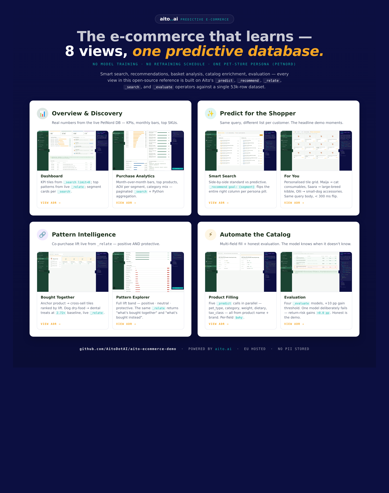

---

## Try it now

The cheatsheet ([`docs/aito-cheatsheet.md`](docs/aito-cheatsheet.md))
carries verified live query bodies for every endpoint. A one-line
probe against the live PetNord DB:

```bash
# Lift query — "what's bought with dog dry-food?" — same body the
# Bought Together view runs on every anchor change.
curl -X POST https://shared.aito.ai/db/aito-ecommerce-demo/api/v1/_relate \
  -H "x-api-key: $AITO_API_KEY" \
  -H "content-type: application/json" \
  -d '{
    "from": "orders",
    "where": { "line_categories": { "$match": "dog_dryfood" } },
    "relate": "line_categories",
    "limit": 5
  }'
# → dog_dentaltreats lift 2.72×, dog_wetfood 1.54×, dog_treats 1.53×, …
```

Returns in ~200 ms. Same query the Dashboard's top-patterns row
runs in parallel × 6 anchors.

---

## The nine demo moments

Nine visible, quotable predictions form the demo's narrative.
Each is in its own view, each builds on the previous:

| # | Moment | View | Aito |
|---|---|---|---|
| 1 | Smart Search rank flip — same query, cat food for a cat owner, dog food for a dog owner | [Smart Search](#2-smart-search--purchase-probability--text-relevance) | `_search` × 2 (`$similarity`, `$multiply`) |
| 2 | For You persona switch — grid re-ranks in <300 ms on pill click | [For You](#3-for-you--personalised-tile-grid) | `_recommend` |
| 3 | Bought Together 2.72× — dog dry-food → dental treats, live | [Bought Together](#4-bought-together--co-purchase-lift) | `_relate` |
| 4 | Product Filling 5 fields — multi-`_predict` in ~480 ms | [Product Filling](#17-product-filling--catalog-enrichment) | `_predict` × 5 |
| 5 | Evaluation honest failure — Return Risk +0.0 pp gain | [Evaluation](#18-evaluation--honest-passfail) | `_evaluate` × 4 |
| 6 | Churn ranking — 100 active customers scored by P(churn in 3 mo) from the time-series panel | [Churn](#10-churn--time-series-prediction-over-the-panel) | `_predict` × N + `_relate` × 5 + `_evaluate` |
| 7 | **Inventory reorder workflow** — critical SKUs ranked by revenue at risk in €, per-row `$why` decomposing the demand forecast | [Inventory](#12-inventory--the-killer-operate-view) | `_estimate` × 25 + `_search` |
| 8 | *Paused:* Markdown decision — the discount that clears overstock at the highest recoverable margin | [Markdown](#14-markdown--inventory--demand--price-one-workflow) | `_estimate` × 5 per SKU |
| 9 | *Paused:* Win-back — products a churned customer is likely to respond to | [Win-back](#16-win-back--empirical-revenue-impact-per-send) | `_recommend` + `_estimate` |

The two-minute narrated walkthrough is in
[`docs/demo-script.md`](docs/demo-script.md).

**Hidden for now:** Demand Forecast, Markdown, Cart Completion and
Win-back. On today's synthetic purchase data they contradict
themselves (a forecast that loses to "same as last month", margin-losing
markdowns, a purchase probability shown as a campaign response rate).
They return when the data is regenerated with realistic purchase
patterns ([ADR 0027](docs/adr/0027-purchase-lifecycle-data.md)). The
code, API and tests stay; the switch is one list,
[`frontend/lib/hidden-routes.ts`](frontend/lib/hidden-routes.ts).

---

## What's inside

Sixteen views grouped under six sidebar sections, all reading
from a single Aito DB. Click any guide for the full
implementation, data-schema excerpts, and tradeoffs.

### 1. 📊 Dashboard — KPIs, top patterns, households, live insight

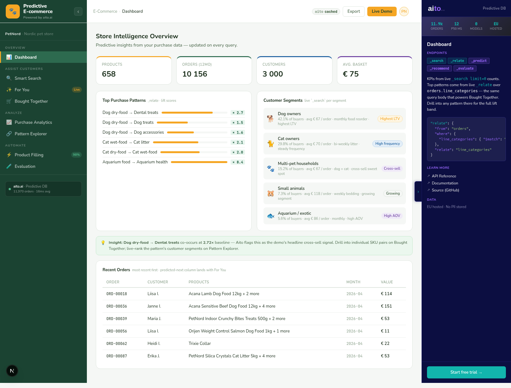

```json
{
  "from": "orders",
  "where": { "line_categories": { "$match": "dog_dryfood" } },
  "relate": "line_categories",
  "limit": 20
}
```

KPI grid + top-patterns bars (six parallel `_relate` calls) +
household cards (counts by declared pets in one `_batch`) + recent orders. Same query
body Bought Together runs per anchor — same 2.72× lift surfaces
in both views.
[→ Implementation](src/overview_service.py) | [Use case guide](docs/use-cases/01-dashboard.md) | [ADR](docs/adr/0005-dashboard.md)

### 2. 🔍 Smart Search — purchase probability × text relevance

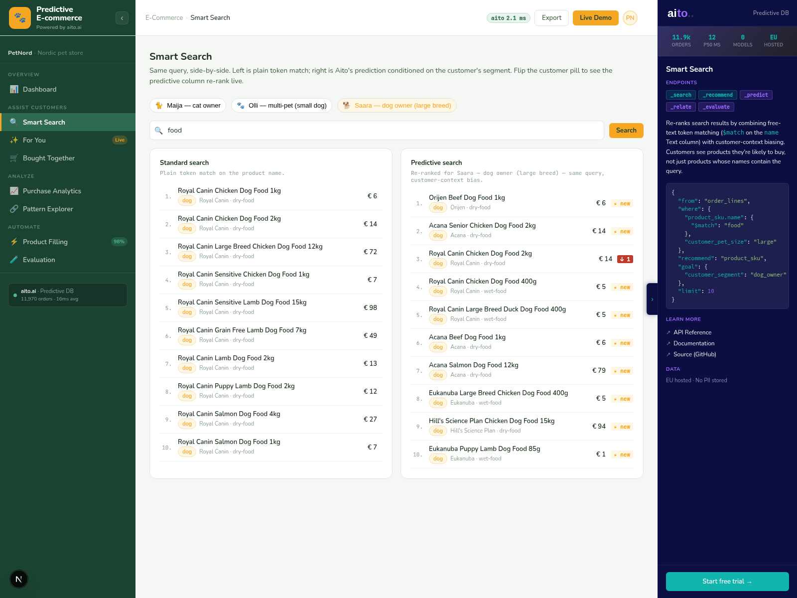

```json
{
  "from": "impressions",
  "get": "product_sku",
  "where": { "context.customer": "CUST-00003" },
  "orderBy": { "$multiply": [
    { "$p": { "$context": { "purchased": true } } },
    { "$similarity": { "name": "food for an old dog" }, "theta": 4.0 }
  ] },
  "limit": 10
}
```

Side by side: BM25 text relevance on the left, and on the right one
`_search` that ranks every product by the probability this shopper
buys it (learned from the `impressions` funnel) times how well its
name matches the query. There's no word filter, so natural phrasing
and misspellings still find products. The `where` holds only the
customer id: Aito learns each shopper from their own impressions,
two links away (`impressions → contexts → customers`). Same query
string, a different customer per persona: the right column flips when you click
the Maija / Olli / Saara pills. Measured on a judged query set
([search-eval](docs/verification/search-eval.md)): nDCG@10 0.29 →
0.52 on the left and 0.29 → 0.57-0.59 on the right (measured
2026-09-28, before ADR 0033). **Demo moment #1.**
[→ Implementation](src/search_service.py) | [Use case guide](docs/use-cases/02-smart-search.md) | [ADR](docs/adr/0026-three-way-smart-search.md)

### 3. ✨ For You — personalised tile grid

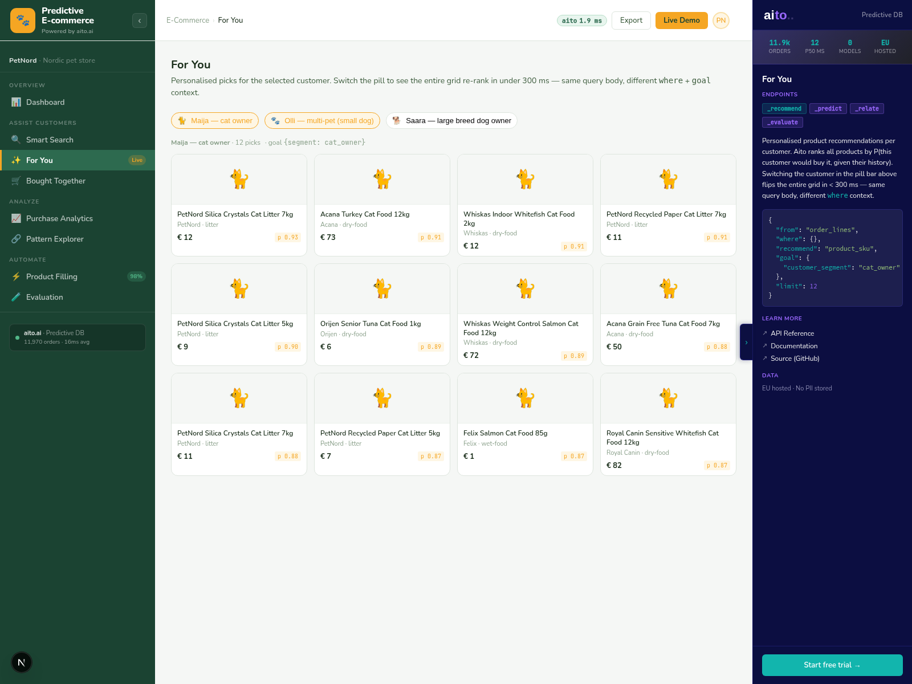

```json
{
  "from": "impressions",
  "where": { "context.customer": "CUST-00003" },
  "recommend": "product_sku",
  "goal": { "purchased": true },
  "limit": 12
}
```

The conversion-KPI `_recommend`: purchase probability learned from
the `impressions` funnel, with no query, for one customer. The whole
catalog re-ranks per persona by purchase probability; Maija (cat
owner) sees cat products at the top, Saara (large breed dog) dog
products. Flip the
goal to `{ clicked: true }` and the grid reorders toward
attention-grabbing items — rank for revenue or for engagement,
your choice. **Demo moment #2.**
[→ Implementation](src/recommend_service.py) | [Use case guide](docs/use-cases/03-for-you.md) | [ADR](docs/adr/0007-for-you.md)

### 4. 🛒 Bought Together — co-purchase lift

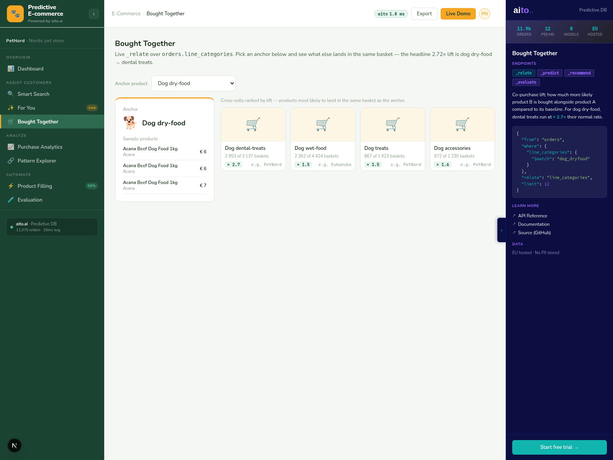

```json
{
  "from": "orders",
  "where": { "line_categories": { "$match": "dog_dryfood" } },
  "relate": "line_categories",
  "limit": 12
}
```

Anchor product + 4 cross-sell tiles with live lift scores. Order-
level co-occurrence via the denormalised `orders.line_categories`
Text column — Aito's `_relate` operating on a single-hop within-
row shape. **Demo moment #3** — dog dry-food → dental treats at
2.72× baseline.
[→ Implementation](src/bought_together_service.py) | [Use case guide](docs/use-cases/04-bought-together.md) | [ADR](docs/adr/0008-bought-together.md)

### 5. 📈 Purchase Analytics — the data behind the predictions

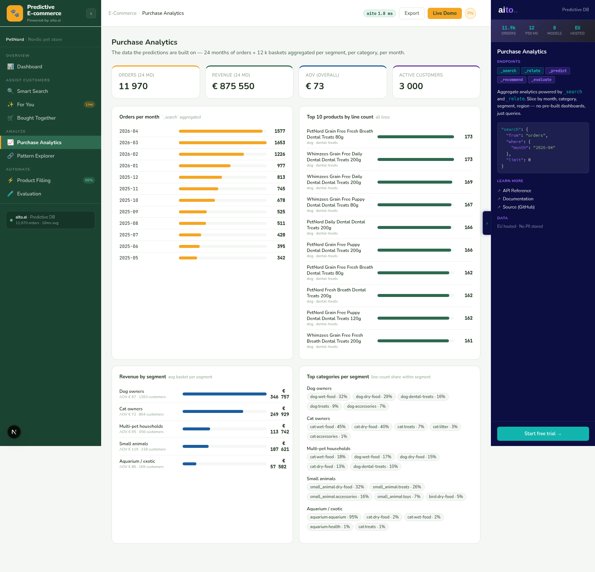

```python
# Page through the table, aggregate locally — Aito doesn't expose
# GROUP BY in _search.
while True:
    res = client.search("orders", limit=5000, offset=offset)
    for o in res["hits"]:
        monthly_counts[o["month"]] += 1
        monthly_revenue[o["month"]] += float(o["total_eur"])
    if len(res["hits"]) < 5000: break
    offset += 5000
```

Monthly orders + revenue (24 months), top-10 SKUs by line count,
KPIs and category mix per household (grouped by declared pets). `_search` with
`offset` pagination + Python aggregation — no new Aito mechanics,
the "show me the numbers" companion to the predictive views.
[→ Implementation](src/analytics_service.py) | [Use case guide](docs/use-cases/05-purchase-analytics.md) | [ADR](docs/adr/0011-analytics-and-patterns.md)

### 6. 🔍 Product Insights — one product, its funnel and its buyers

```python
# Who buys it: `_relate` over this product's order lines, one call per
# declared buyer field, two links away. Lift = how much more common the
# value is among this product's lines than among all lines; `fs` carries
# the counts.
{"from": "order_lines", "where": {"product_sku": "SKU-PT-0177"},
 "relate": "order_id.customer_id.pets"}
```

Pick any product. The page shows:
- its funnel (shown → clicked → added to cart → purchased);
- each surface's purchase rate;
- the households that buy it more or less than average (declared pets, dog size, diet, region), each with its counts;
- units per month and its reviews.

The ~20 counts go in one `_batch`. The `_relate` calls run in parallel, and the query pane shows one of the `_relate` bodies sent (the declared-pets one).
[→ Implementation](src/product_insights_service.py) | [Use case guide](docs/use-cases/17-product-insights.md) | [ADR](docs/adr/0028-product-insights.md)

### 7. 🏪 Shop analytics — the patterns behind the shop

```python
# What goes with a purchase: one field-form `_relate` per field, in
# parallel. Each hit's `fs` gives the counts behind its interval.
client.relate(
    table="impressions",
    where={"purchased": True},
    relate_field="product_sku.rating_band",
)
```

Four sections, each its own endpoint and a set of parallel `_relate`s:
- what goes with a purchase or a click (rating, category, the product's state that month, declared pets and diet, "in their last order", surface);
- who buys what, and when: categories and dietary lines for a season, declared pets or diet;
- category pairs that share a basket;
- the search words that convert above and below the average search.

Each lift is shown with its counts and an interval that accounts for two things: one customer's rows are not independent (a design effect measured from `_relate`s on the customer column), and a section tests dozens of lifts at once (Bonferroni, 95 % for the section). A lift is shown only if that interval excludes 1 and it rests on 30 or more independent rows. Needs ADR 0033's data (test env `observable` until master is reloaded).
[→ Implementation](src/shop_analytics_service.py) | [Use case guide](docs/use-cases/18-shop-analytics.md) | [ADR](docs/adr/0031-interactive-shop-and-owner-analytics.md)

### 8. 🔗 Pattern Explorer — the full lift band

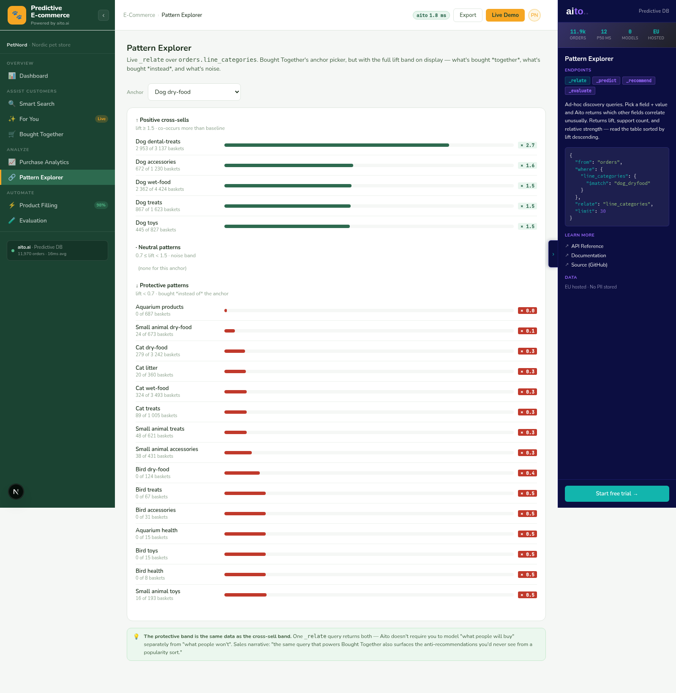

```json
{
  "from": "orders",
  "where": { "line_categories": { "$match": "dog_dryfood" } },
  "relate": "line_categories",
  "limit": 30
}
```

Same `_relate` body Bought Together uses, no lift filter. Surfaces
the **full band** — positive (green, lift ≥ 1.5), neutral (grey),
protective (red, lift < 0.7). The "what's NOT bought together"
side of the equation, plus richer fields per row (lift, support
counts, p_given vs. p_overall).
[→ Implementation](src/pattern_service.py) | [Use case guide](docs/use-cases/06-pattern-explorer.md) | [ADR](docs/adr/0011-analytics-and-patterns.md)

### 9. 💬 Feedback — review triage + churn risk from text

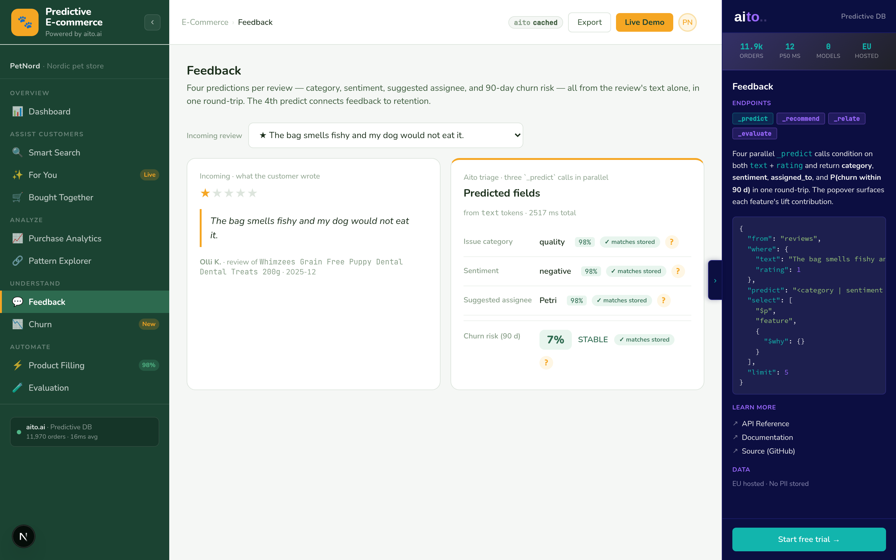

```json
{
  "from": "reviews",
  "where": { "text": "Package arrived late. The seal was broken." },
  "predict": "churn_within_90d"
}
```

Four parallel `_predict` calls over the review's `text` Text
column return **category**, **sentiment**, the suggested
**assigned_to** agent, AND a forward-looking **churn risk** —
all from the text alone, in one round-trip. The 4th predict
connects feedback to retention: a complaint about late delivery
lights up a red risk chip; positive praise stays green.
[→ Implementation](src/feedback_service.py) | [Use case guide](docs/use-cases/09-feedback.md) | [ADR](docs/adr/0012-feedback-multi-predict.md)

### 10. 📉 Churn — time-series prediction over the panel

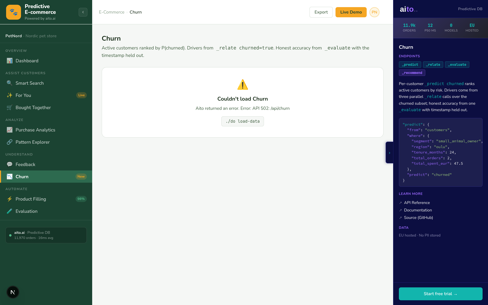

```json
{
  "from": "customer_months",
  "where": {
    "pets": "small_animal",
    "region": "oulu",
    "tenure_months_at_month": 20,
    "visits": 4,
    "purchases": 0,
    "spent_eur": 0,
    "latest_rating": 2,
    "latest_category": "shipping"
  },
  "predict": "churned_in_3_months"
}
```

Panel-data churn prediction: one row per customer per month with
visits, purchases, spend, what the household declared (pets, dog
size) and its region, and the latest review snapshot.
Each active customer's *latest row* scored with `_predict
churned_in_3_months`; drivers via `_relate` over churned
customers, per declared field and tenure band; held-out accuracy via `_evaluate`. The killer
feature of the Understand section.
[→ Implementation](src/churn_service.py) | [Use case guide](docs/use-cases/10-churn.md) | [ADR](docs/adr/0013-churn-prediction.md)

### 11. 📦 Demand Forecast — `_estimate units_sold`, judged against naive

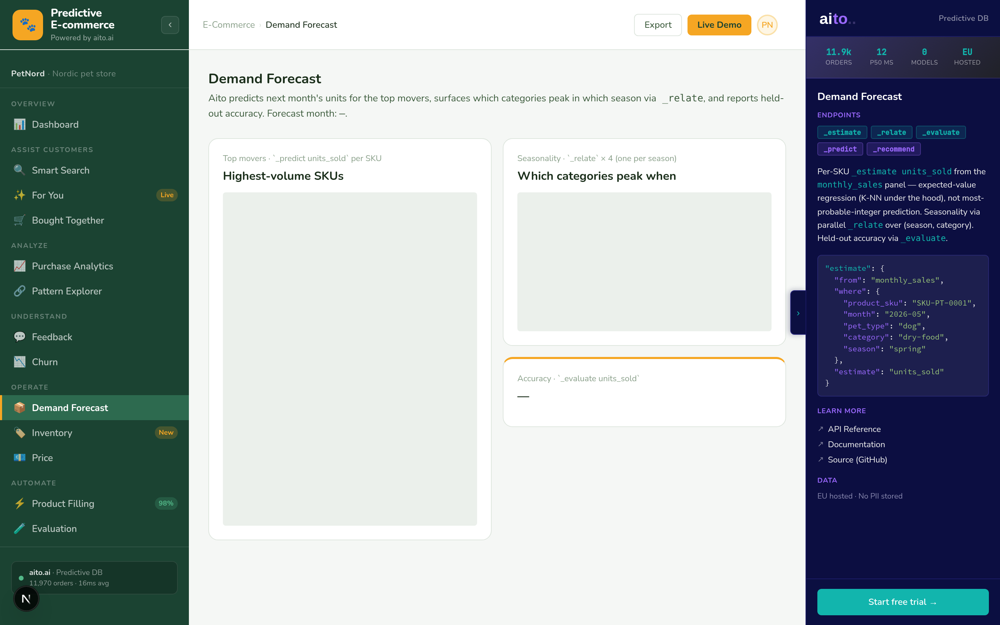

```json
{
  "from": "monthly_sales",
  "where": {
    "product_sku": "SKU-PT-0042",
    "units_last_month": 14,
    "pet_type": "dog",
    "category": "dry-food",
    "brand": "Royal Canin",
    "season": "spring"
  },
  "estimate": "units_sold"
}
```

Per-SKU next-month units via 25 parallel `_estimate` calls over the
`monthly_sales` panel, conditioned on last month's sales. Seasonality
drivers come from four parallel `_relate` calls (one per season).
Accuracy is a time split: train on earlier months, test on the latest.
It is shown next to the naive "same as last month" forecast, which is
the bar a forecast has to clear. Forecasts feed the Inventory view's
reorder workflow directly.
[→ Implementation](src/demand_service.py) | [Use case guide](docs/use-cases/11-demand-forecast.md) | [ADR](docs/adr/0014-demand.md)

### 12. 🏷️ Inventory — the killer Operate view

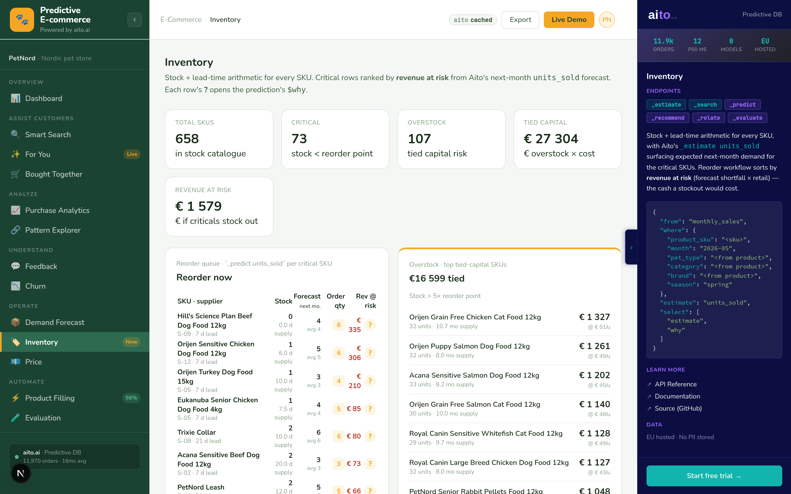

```json
{
  "from": "monthly_sales",
  "where": {
    "product_sku": "SKU-PT-0042",
    "units_last_month": 14,
    "category": "dry-food",
    "season": "spring"
  },
  "estimate": "units_sold"
}
```

The same next-month forecast as Demand (`src/demand_forecast.py`).
KPI strip with **revenue at risk** in €, reorder queue ranked by
forecast shortfall × retail price, per-row `?` opens the demand
forecast's `$why`. Plus an overstock list with tied-capital
figures. The merchandiser's daily dashboard, with Aito doing the
prediction underneath.
[→ Implementation](src/inventory_service.py) | [Use case guide](docs/use-cases/12-inventory-intelligence.md) | [ADR](docs/adr/0015-inventory.md)

### 13. 💶 Price Intelligence — fair-band + sweet-spot `_relate`

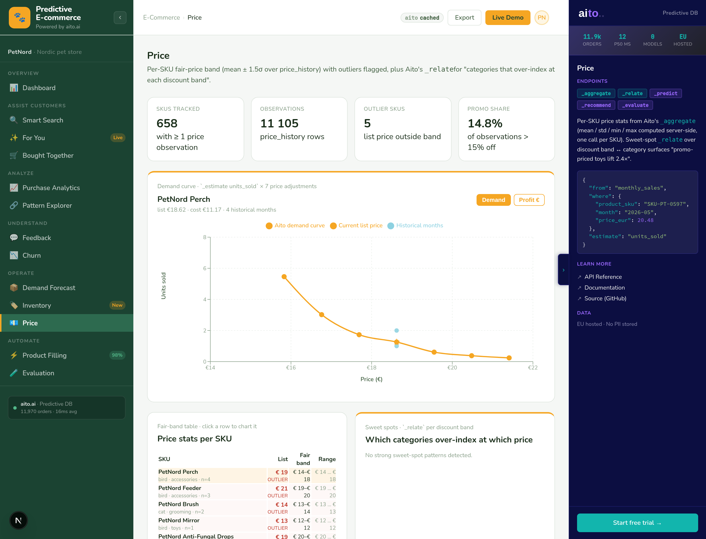

```json
{
  "from": "product_states",
  "where": { "discount_pct": { "$gt": 15.0 } },
  "relate": "product_sku.category"
}
```

Per-SKU fair-band stats from `product_states` (one row per product and
month on sale, ADR 0032; mean ± 1.5σ, outliers
flagged), and a demand curve per SKU: `_estimate units_sold` at seven
prices within ±10 % of its average selling price. Three parallel
`_relate` calls over discount bands ↔ category look for categories that
are discounted more than others; on today's data none is, so that card
stays hidden (ADR 0016 amendment). The `_relate`-via-banding pattern
transfers to any continuous column.

**What if:** click a curve point or drag the slider to see next month's
units, revenue and profit at that price, and why: one regression
`_estimate` explains the estimate as a typical month times one factor
per fact ("sold 23 last month ×2.98", "price €4.68 ×0.48"), and the
rows multiply out to it exactly. The SKU and price are in the URL.
[→ Implementation](src/price_service.py) · [What-if](src/price_what_if.py) | [Use case guide](docs/use-cases/13-price.md) | [ADR](docs/adr/0016-price.md) · [ADR 0029](docs/adr/0029-price-what-if.md)

### 14. ✂️ Markdown — Inventory + Demand + Price, one workflow


```json
{
  "from": "monthly_sales",
  "where": {
    "product_sku":      "SKU-PT-0042",
    "units_last_month": 14,
    "price_eur":        72.20,
    "category":         "dry-food",
    "season":           "spring"
  },
  "estimate": "units_sold"
}
```

For each overstock SKU, `_estimate units_sold` runs at five
markdown levels (0/5/10/15/20 %). View picks the markdown that
maximises recoverable revenue while clearing the excess within
3 months. If no markdown ≤ 20 % clears in horizon, the row is
flagged "won't clear in horizon" — honest signal.
**Demo moment #8.**
[→ Implementation](src/markdown_service.py) | [Use case guide](docs/use-cases/14-markdown.md) | [ADR](docs/adr/0018-markdown.md)

### Shop — be a shopper, and watch Aito re-rank

```json
{
  "from": "impressions",
  "where": { "context.customer.pets": { "$and": [{ "$match": "small_animal" }] },
             "context.month": "2026-04",
             "just_bought": false,
             "product_sku.pet_type": { "$or": ["small_animal"] } },
  "recommend": "product_sku",
  "goal": { "purchased": true },
  "select": ["sku", "name", "brand", "pet_type", "category", "price_eur", "avg_rating", "$p", "$why"],
  "limit": 20
}
```

Six shoppers, each a real customer whose story the data backs. Aito
sees only what a shop observes (ADR 0033): the customer id, what the
household declared, and the visit. One view per intent: **Buy again**
(`_predict "skus.$feature"` over the shopper's own orders), **Next for
their kit** (`_predict product_sku` over order lines whose order owned
what they own) and **Picked for you** (above: declared pets, month and
cart as context; their pets and diet rule as filters). What they just
bought is re-asked and falls. A product opens with what's often in the
same basket.
[→ Implementation](src/shop_grid.py) | [Use case guide](docs/use-cases/19-shop.md) | [ADR](docs/adr/0031-interactive-shop-and-owner-analytics.md)

### 15. 🛒 Cart Completion — checkout-funnel personalisation


```json
{
  "from":   "orders",
  "where":  { "line_categories": { "$match": "dog_dryfood" } },
  "relate": "line_categories",
  "limit":  10
}
```

Four preset checkout carts × `_relate` over
`orders.line_categories` = top add-on suggestion per scenario
with confidence + expected uplift €. Same engine as Bought
Together, surfaced at the checkout funnel.
[→ Implementation](src/cart_completion_service.py) | [Use case guide](docs/use-cases/15-cart-completion.md) | [ADR](docs/adr/0019-cart-completion.md)

### 16. ↩️ Win-back — empirical revenue impact per send


```json
{
  "from": "winback_campaigns",
  "where": {
    "customer_id":              "CUST-00022",
    "customer_staple_category": "dog/dry-food",
    "recency_bucket":           "90-180d"
  },
  "recommend": "product_sku",
  "goal":      { "responded": true },
  "basedOn":   ["pet_type", "category", "brand"],
  "limit":     8
}
```

For each currently-churned customer (top-20 by lifetime €),
Aito's `_recommend product_sku from winback_campaigns goal
{responded: true}` ranks products by predicted email response
rate; `_estimate order_value_eur` per suggestion gives the AOV
forecast. The customer goes in as their id (a link to what they
declared and their earlier sends), with their staple from their orders
and how long since they last ordered. **Demo moment #9.** Ports the
Netigate action+impact pattern.
[→ Implementation](src/winback_service.py) | [Use case guide](docs/use-cases/16-winback.md) | [ADR](docs/adr/0020-winback.md)

### 17. ⚡ Product Filling — catalog enrichment

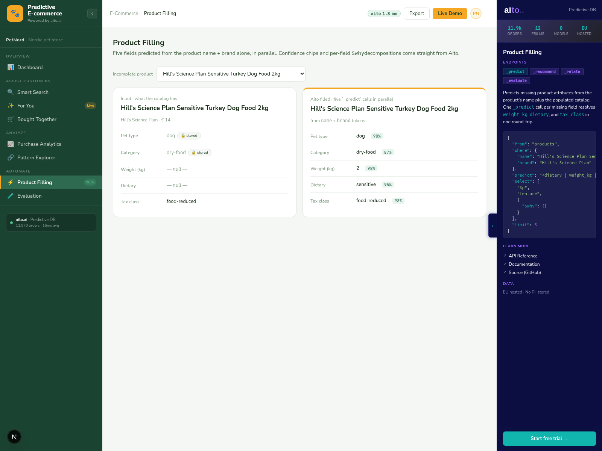

```python
# 5 _predict calls in parallel, one per field, same `where`
where = {"name": "Hill's Sensitive Adult Dog Turkey 2kg",
         "brand": "Hill's Science Plan"}
for predict_field in ["pet_type", "category", "weight_kg", "dietary", "tax_class"]:
    client.predict("products", where=where,
                   predict_field=predict_field, limit=5)
```

Five product attributes — pet_type, category, weight_kg, dietary,
tax_class — predicted in parallel from a single product's name +
brand. Each field renders with confidence chip + top-3
alternatives + `$why` factor tooltip. **Demo moment #4** — all
five at ≥ 0.87 in ~480 ms.
[→ Implementation](src/filling_service.py) | [Use case guide](docs/use-cases/07-product-filling.md) | [ADR](docs/adr/0009-product-filling.md)

### 18. 🧪 Evaluation — honest pass/fail

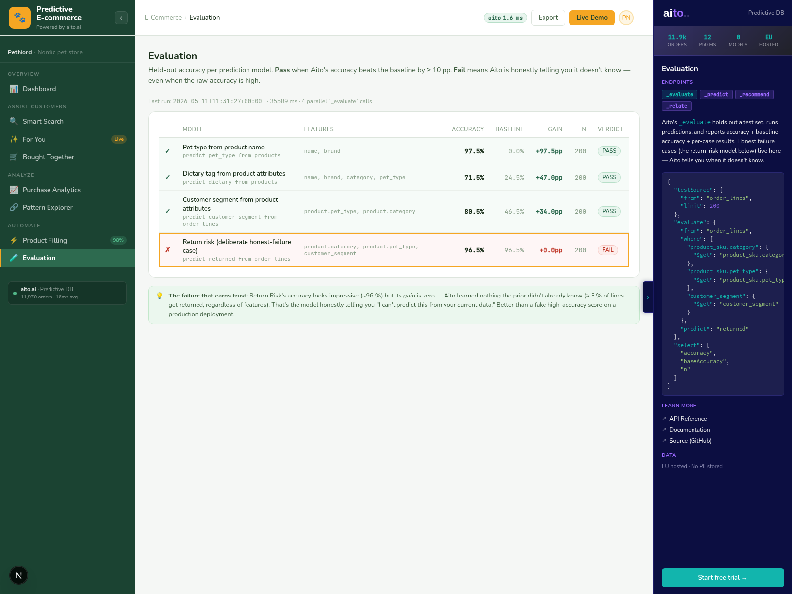

```json
{
  "test": { "$sample": { "n": 200, "seed": 0 } },
  "evaluate": {
    "from": "order_lines",
    "where": {
      "product_sku.category": { "$get": "product_sku.category" },
      "product_sku.pet_type": { "$get": "product_sku.pet_type" }
    },
    "predict": "returned"
  },
  "select": ["accuracy", "baseAccuracy", "n"]
}
```

Three `_evaluate` calls in parallel, two pass, **one honest
failure**. The "Return Risk" model deliberately fails its 10 pp
threshold — the 3% returned rate has no signal Aito can beat the
baseline on, and the view renders that as a red row. **Demo
moment #5.**
[→ Implementation](src/eval_service.py) | [Use case guide](docs/use-cases/08-evaluation.md) | [ADR](docs/adr/0010-evaluation.md)

---

## Quick start

```bash
git clone https://github.com/AitoDotAI/aito-ecommerce-demo
cd aito-ecommerce-demo

# 1. Drop your Aito credentials into .env
cp .env.example .env
$EDITOR .env

# 2. Install deps
./do setup

# 3. (Optional) Regenerate the PetNord dataset + upload to Aito
./do generate-fixtures
./do reset-data           # upload + warm light views + precompute the six
                          # heavy views' snapshots, ~3 min

# 4. Run
./do dev
# → http://localhost:8500
```

`./do help` lists every verb.

### R&D environment (don't experiment on the shared DB)

`AITO_API_URL` in `.env` points at a **shared** instance — the deployed
demo and every local checkout use the same Aito DB, and the Layer-2
prediction cache is a table *on that instance*. So running experimental
code against it (re-pointed queries, new tables) writes cache rows the
deployed app then serves, cross-contaminating prod.

Keep R&D isolated by overriding the connection in **`.env.local`**
(gitignored; `./do` sources it after `.env`, so it wins over `.env`; a
variable you export yourself wins over both). When the URL in effect is
the shared demo instance, `./do` **refuses** the verbs that write —
`load-data`, `reset-data`, `clear-cache` — rather than only warning,
because a warning did not stop an interrupted `load-data` from taking the
live dashboard down. Reads, and the `optimize` remedy, are never gated.
If you really do mean the shared instance, say so:
`AITO_ALLOW_PROD=1 ./do load-data`.

```bash
# .env.local — your personal dev instance
AITO_API_URL=https://shared.aito.ai/db/aito-ecommerce-dev
AITO_API_KEY=your-dev-instance-key
```

```bash
./do reset-data    # rebuilds the dev instance from fixtures (seed=42)
                   # — an exact, mutable copy of prod
```

### Which Aito API does it use?

**v2 (Rep2), against `master`.** The staged `v2` env was promoted onto
master on 2026-09-23, so master IS the migrated database — there is no
second env to point at or keep in sync. `AITO_USE_V2` is an opt-OUT, so a
deployment that sets nothing gets v2:

```bash
./do dev                  # v2 against master
AITO_USE_V2=0 ./do dev    # v1 against master — still supported
AITO_ENV=pr-42 ./do dev   # a feature-branch sandbox env
```

Because master's *storage* is rep2, the v1 path now reaches it through
Aito's engine-dispatched adapter rather than a separate rep1 database.
That is the migration Aito sells — move the storage, change no
application code — so the fallback doubles as a live test of it.

v1 is not removed. `src/aito_compat.py` normalises both at the transport
boundary, the live checks pass on either, and `AITO_USE_V2=0` is the way
back if v2 has to be rolled off. Cache entries and precompute snapshots
are scoped per `version@env`, so the two never serve each other's
answers.

### Which commit is deployed?

`GET /version` — mirroring Aito's own `/version`, so asking a demo and
asking the database it runs on are the same gesture. Aito-free, so it
still answers when the database does not:

```json
{ "build":  { "sha": "755db4c164d9", "source": "BUILD_SHA", "dirty": null },
  "api":    "v2@v2",
  "pinned": true }
```

`pinned: false` means the build cannot say where it came from. The same
`build` and `api` fields also ride along on `GET /api/health`.

Served at **both `/version` and `/api/version`**. The root path matches
Aito's own convention; the `/api/` one is there because a deployment
that proxies only `/api/*` would otherwise never reach it — and an
endpoint whose whole job is to be askable must not depend on a routing
assumption.

**Set `BUILD_SHA` at build time in any deployment.** A deployed image has
no `.git`, so that variable is the only trustworthy source; `source:
"git"` in production means the build is not pinned, which is itself the
finding. This exists because the deployed demo has twice served
behaviour that was in no git branch, and both times it was caught only
by noticing impossible output in the UI.

`api` answers the other half of "why does this look wrong": which engine
and env produced the results.


Because the dataset is fully code-defined (schema in `data_loader.py`,
data in `generate_fixtures.py`, deterministic), a dev instance *is* a
copy of prod — no server-side clone needed. The cache lives on whichever
instance you target, so prod is never touched. The `load-data` /
`reset-data` / `clear-cache` / `warm-cache` verbs print the target
instance (and flag the shared one) so you always know which you hit.

---

## How it works

```
Browser → Next.js (port 8500) → fetch("/api/...") → FastAPI (port 8501)
                                                      ↕
                                                    AitoClient
                                                      ↕
                                                    Aito REST API
                                                      ↕
                                                    two-layer cache
                                                    (memory + Aito table)
```

- **Backend** — Python 3.12 + FastAPI. One service module per view
  (`src/<view>_service.py`). Each module builds an Aito query body,
  calls `AitoClient`, and translates the response to a DTO the
  frontend renders.
- **Frontend** — Next.js 16 (App Router) + TypeScript. One page per
  view in `frontend/app/<view>/page.tsx`. The locked Aito side
  panel reads its config from `frontend/lib/panel-content.ts` and
  updates its `query` block with the actual body that ran.
- **Schema** — `src/schema.py`. Core tables (`products`,
  `customers`, `orders`, `order_lines`), the shopper funnel
  (`impressions → contexts → customers`), `product_states` (each
  product as it was in a month, ADR 0032) and the panels the
  Understand views read. Links are chained, so a query reaches
  `context.customer.pets` or `order_id.customer_id.diet` through two
  links without manual joins. Tables hold only what a shop observes
  (ADR 0033): `customers` has what the household declared (pets, dog
  size, diet) and its recorded history, never the hidden traits the
  data generator uses to produce behaviour. `orders.line_categories`
  is denormalised Text for order-level co-occurrence.
- **Caching** — Two mechanisms, split by cost. The nine *light* views
  use a lazy two-layer cache (`cache.py`): in-memory LRU per process +
  Aito-backed `prediction_cache` table that survives restarts, computed
  on first hit (read-only keys disable the persistent layer cleanly).
  The six *heavy* views (churn, demand, evaluation, inventory, markdown,
  win-back) — plus the **dashboard** landing page, which looks light but
  runs ~321 sequential `_search` calls (~93 s cold, the heaviest cold
  page) — are **precompute-and-served** (`precompute_store.py`, ADR
  0024): `./do precompute` runs that work offline and snapshots each
  result into an Aito `precompute_entries` table plus a git-committed
  JSON bootstrap, so the app only ever reads.
  Reads need just a read key, so the read-only public deploy opens those
  pages in well under a second even on a cold container.

---

## Aito operators used

| Operator | What it does | Used in |
|---|---|---|
| `_search` | Retrieve rows / count via `limit=0`; rank by `$similarity` or `$multiply` | Dashboard KPIs, Smart Search (both columns), Purchase Analytics, Bought Together sample SKUs, Price aggregation, Inventory snapshot |
| `_match` (via `$match`) | Token match on Text columns | Bought Together (`line_categories`), Pattern Explorer |
| `_recommend` | Rank rows by `P(goal | row)` | For You, Shop "Picked for you" and search, Win-back |
| `_relate` | Co-occurrence with lift / support / `pOnCondition` | Dashboard top patterns, Bought Together, Pattern Explorer, Churn profile drivers (fields + tenure bands), Demand seasonality × 4 parallel, Price sweet-spot × 3 parallel |
| `_predict` | Predict a field with `$p` + `$why` factor tree | Product Filling × 5 parallel, Feedback × 4 parallel, Churn at-risk × N parallel, Demand × 25 parallel, Inventory × 25 parallel |
| `_evaluate` | Cross-validation accuracy + baseline + per-row results | Evaluation × 3 parallel, Churn × 1, Demand × 1 |

Verified query bodies + Aito-API gotchas (multi-field `goal`
semantics, hyphen tokenisation, single-hop link traversal, the
`_evaluate` body shape) are captured in
[`docs/aito-cheatsheet.md`](docs/aito-cheatsheet.md).

---

## Project structure

```
src/                Python FastAPI backend
  app.py              All endpoints — table of contents
  aito_client.py      Thin REST wrapper, retries + `$why`-decorated `_predict`
  cache.py            Two-layer lazy cache (memory + Aito table) — light views
  precompute_store.py Precompute-and-serve store (Aito + git JSON) — heavy views
  precompute.py       Offline snapshot driver for the six heavy views
  rate_limit.py       Two-tier rate limiter (per-IP + global)
  data_loader.py      Schema + fixture upload
  overview_service.py    Dashboard
  search_service.py      Smart Search
  recommend_service.py   For You
  bought_together_service.py
  pattern_service.py
  analytics_service.py
  feedback_service.py
  churn_service.py
  demand_service.py
  inventory_service.py
  price_service.py
  filling_service.py
  eval_service.py

frontend/           Next.js 16 (App Router)
  app/<view>/page.tsx           per-view pages
  components/shell/             AppShell · TopBar · Sidebar · AitoPanel · ErrorState · ScaffoldStub
  components/prediction/        PredictionBadge · ConfidenceBar · WhyTooltip · PredictedField · LiftHint
  lib/api.ts                    apiFetch + latency-event broadcast
  lib/panel-content.ts          per-view Aito-panel configs
  lib/types.ts                  shared DTOs

data/               Deterministic JSON fixtures (seed = 42)
  generate_fixtures.py          single source of truth — re-runs idempotent
  products.json · customers.json · orders.json · order_lines.json
  reviews.json · customer_months.json
  monthly_sales.json · inventory.json · product_states.json
  contexts.json · impressions.json · winback_campaigns.json

tests/              pytest — fixture signal checks + AitoClient body shape
screenshots/        Canonical per-view screenshots (the inspect/ subfolder is the workshop)
docs/
  use-cases/                    8 per-view implementation guides
  adr/                          11 Architecture Decision Records — read these first
  aito-cheatsheet.md            verified query patterns + Aito gotchas we hit
  demo-script.md                two-minute walkthrough
  product-sheet/                outreach PDF
  sessions/                     session logs (the working notebook)
do                              task runner — `./do help`
```

Ports: Next.js on **8500**, FastAPI on **8501**.

---

## Deep dive

- **[Use case guides](docs/use-cases/)** — 8 per-view
  implementation guides with code, schema, and tradeoffs
- **[Architecture Decision Records](docs/adr/)** — 11 ADRs walking
  the design rationale top-to-bottom
- **[Aito cheatsheet](docs/aito-cheatsheet.md)** — verified live
  query bodies + the Aito-API gotchas we hit during the build
- **[Demo script](docs/demo-script.md)** — two-minute narrated
  walkthrough; five demo moments in narrative order
- **[Cross-demo framework](aito-demo-framework.md)** — the
  conventions shared across the family of Aito vertical demos
- **[TASK.md](TASK.md)** — the working brief that drove the build

---

## ADRs

Read top-to-bottom and you have the demo's full design rationale.

| # | Title | Status |
|---|---|---|
| 0001 | [Scaffold + stack mirrored from `aito-erp-demo`](docs/adr/0001-scaffold-and-stack.md) | Accepted |
| 0002 | [Data model + deterministic fixtures](docs/adr/0002-data-model-and-fixtures.md) | Accepted |
| 0003 | [Aito schema, data loader, query-method surface](docs/adr/0003-aito-schema-and-loader.md) | Accepted |
| 0004 | [Layout shell + design tokens](docs/adr/0004-layout-shell.md) | Accepted |
| 0005 | [Dashboard view + overview_service](docs/adr/0005-dashboard.md) | Accepted |
| 0006 | [Smart Search — predictive re-ranking](docs/adr/0006-smart-search.md) | Accepted |
| 0007 | [For You — personalised tile grid + persona switcher](docs/adr/0007-for-you.md) | Accepted |
| 0008 | [Bought Together — order-level co-occurrence](docs/adr/0008-bought-together.md) | Accepted |
| 0009 | [Product Filling — multi-field `_predict`](docs/adr/0009-product-filling.md) | Accepted |
| 0010 | [Evaluation — honest pass/fail](docs/adr/0010-evaluation.md) | Accepted |
| 0011 | [Purchase Analytics + Pattern Explorer](docs/adr/0011-analytics-and-patterns.md) | Accepted |
| 0012 | [Feedback — multi-field `_predict` over review text](docs/adr/0012-feedback-multi-predict.md) | Accepted |
| 0013 | [Churn — the killer Understand view](docs/adr/0013-churn-prediction.md) | Accepted |
| 0014 | [Demand Forecast — `_estimate units_sold`, time-split accuracy against the naive forecast](docs/adr/0014-demand.md) | Accepted |
| 0015 | [Inventory Intelligence — the killer Operate view](docs/adr/0015-inventory.md) | Accepted |
| 0016 | [Price Intelligence — fair-band + sweet-spot `_relate`](docs/adr/0016-price.md) | Accepted |
| 0030 | [Shoppers with a story — personas, guided kits, seasons, routines](docs/adr/0030-shoppers-with-a-story.md) | Accepted |
| 0031 | [An interactive shop, and the owner's view of its patterns](docs/adr/0031-interactive-shop-and-owner-analytics.md) | Accepted |
| 0032 | [Product states — a product as it is this month](docs/adr/0032-product-states.md) | Accepted |
| 0033 | [Only what a shop can observe — impressions, contexts and customers](docs/adr/0033-only-what-a-shop-observes.md) | Accepted |

ADRs 0017–0029 are in [`docs/adr/`](docs/adr/).

---

## EU hosted · No PII stored

`customer_id` is anonymous (`CUST-NNNNN`). The Aito DB lives in
the EU. Public-demo deployments run with `PUBLIC_DEMO=1` which
locks down CORS, returns 404 from `/api/schema`, and disables the
write side of the cache so a read-only API key is sufficient.

---

## Companion demos

The Aito predictive-database family of OSS vertical demos:

- **[aito-accounting-demo](https://github.com/AitoDotAI/aito-accounting-demo)** —
  *Predictive Ledger*. Multi-tenant AP automation: GL coding,
  approver routing, payment matching, anomaly detection. 255
  customers, 128K invoices, one shared Aito instance.
- **[aito-erp-demo](https://github.com/AitoDotAI/aito-erp-demo)** —
  *Predictive ERP*. Procurement-to-pay workflow loop: PO routing,
  smart entry, approval routing, inventory replenishment. Three
  industry profiles (industrial maintenance / retail / services).
- **[aito-demo](https://github.com/AitoDotAI/aito-demo)** — the
  original grocery e-commerce reference; the `ContextPanel`
  design here is the canonical Aito-panel pattern the vertical
  demos import.

---

*Apache 2.0 licensed. Open issues, send PRs, fork into your own
e-commerce vertical.*
